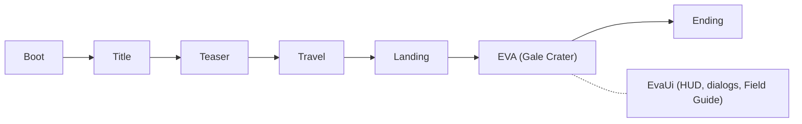
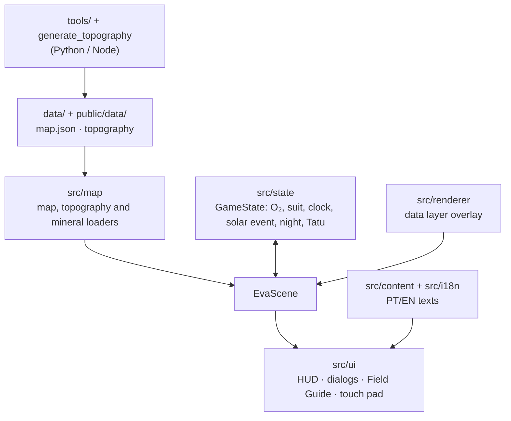

<div align="center">

# Ankerona: Mission Mars

**A Mars survival guide you can play.**
A 2D pixel-art browser game where every discovery comes with the real data and its source.

*Hypothetical mission · real NASA data*

### ▶ [Play now: ankerona.vercel.app](https://ankerona.vercel.app)

NASA Space Apps Challenge 2026 · Challenge **Interplanetary Survival Guide: Martian Map** · Team **Seldon Expedition** (Recife, Brazil)

🌐 **English** · **[Português](README.pt-BR.md)** · [How to run](#how-to-run) · [Sources and references](#sources-and-references) · [Documentation](#documentation)

</div>

---

## Contents

1. [The problem](#the-problem)
2. [The solution](#the-solution)
3. [How the game answers the challenge](#how-the-game-answers-the-challenge)
4. [The game](#the-game)
5. [Scientific data used in the game](#scientific-data-used-in-the-game)
6. [Sources and references](#sources-and-references)
7. [Documentation](#documentation)
8. [Tech stack](#tech-stack)
9. [Architecture](#architecture)
10. [How to run](#how-to-run)
11. [Repository structure](#repository-structure)
12. [Contributing](#contributing)
13. [Team](#team)
14. [AI use and credits](#ai-use-and-credits)
15. [License](#license)

---

## The problem

**57% of people worldwide say they know little or nothing about science.** At the same time, **62% want to learn more**, but only **28% looked for science information in the past month** (Wellcome Global Monitor 2018, more than 140,000 people in more than 140 countries).

The curiosity is there, but access does not keep up. Meanwhile, NASA keeps a huge volume of open planetary data: just one node of its planetary archive, the PDS Geosciences Node, holds about 390 TB. The data is public, but it is technical, in English and hard to explore for non-specialists.

## The solution

**Ankerona** turns real data from Mars missions into a **playable field guide**.

The player controls geologist **Ana Selari** on a (hypothetical) crewed mission to **Gale Crater**, where the Curiosity rover has worked since 2012. She follows a route with real science targets, manages oxygen, battery and suit integrity, faces a solar particle event and returns to the habitat. Every discovery goes into the Field Guide with the data, a survival lesson and its **source**.

- **Free**, runs in the browser, including on phones.
- **Bilingual:** Brazilian Portuguese (PT-BR) and English (EN-US).
- **No science fiction:** the mission is hypothetical and the game says so, but all the science is real and cited. When a value is simulated for gameplay, the game itself says so.

## How the game answers the challenge

The challenge asks for a layered, integrated view of a location or route on Mars that brings together data from several NASA science missions, to help a human explorer plan and carry out a walk on the surface (a Marswalk) while doing science along the way.

| What the challenge asks for | How Ankerona answers |
|---|---|
| A location or route on the surface of Mars | A route in Gale Crater: habitat → Yellowknife Bay → Bagnold Dunes → boxwork formations → return |
| A layered view | Switchable layers: **Map**, **Topography**, **Minerals** and **Terrain** (soft sand and sharp rocks) |
| Data from several NASA missions | Curiosity (RAD, REMS, Mastcam, APXS), Mars Odyssey (MARIE), Phoenix, Spirit, Opportunity, Perseverance (SuperCam) and MRO (HiRISE and CRISM as the basis for the layers) |
| Planning the Marswalk | Management of O₂, battery and suit integrity; terrain that blocks or wears you down; shelters (habitat and pressurized rover) |
| Current conditions | Tatu's weather and radiation panel, accumulated dose in mSv and a solar event alert |
| Science along the way | Each target has a briefing (what it is, why go, what to look for, source) and a Field Guide entry |

> **Pending:** cross-check this table, item by item, against the official list in the challenge page's *Resources* tab.

## The game

**Genre:** 2D pixel-art adventure in the style of an 8-bit handheld console, with a beginning, a middle and an end.

### Flow

1. **Prologue:** the story of space exploration up to Mars, the ~7-month journey and a solar storm alert aboard the ship.
2. **Landing (EDL):** entry with a heat shield, parachute and powered descent down to touchdown, the "seven minutes of terror".
3. **Phase 1 · Yellowknife Bay:** rocks that record an ancient lake.
4. **Phase 2 · Bagnold Dunes:** active dunes and soft sand.
5. **Solar event:** solar particles arrive, a race to the shelter with the crew and the real consequences of exposure.
6. **Phase 3 · Boxwork formations:** mineral ridges on Mount Sharp, across sharp rocks.
7. **Return and epilogue:** back to the habitat and the closing message, *"Now the path is yours."*

### Characters

- **Ana Selari**, geologist and protagonist.
- **Cmdr. Keli Hastor**, **Eng. Rossi Brook** and **Dr. Natan Jonas**, the crew.
- **Tatu**, the guide rover. It rolls ahead to show the way and gathers the mission data: target, guide, weather, radiation and crater map. Details in section 04 of the [**Ankerona documentation**](docs/en/ankerona-documentation.md).

Full profiles in section 03 of the [**Ankerona documentation**](docs/en/ankerona-documentation.md).

The name **Ankerona** combines the first syllables of **An**ca, **Ke**lly, **Ro**ss and **Na**than, the crew of NASA's first **CHAPEA** mission, who lived 378 days in a habitat that simulates Mars (2023–2024). The characters' names are also a tribute to that crew. The full story is in section 02 of the [**Ankerona documentation**](docs/en/ankerona-documentation.md).

### Mechanics

- **Resources:** O₂, battery and suit. Data layers drain battery, soft sand uses more O₂ and sharp rocks damage the suit.
- **Radiation:** accumulated dose in mSv. During the solar event, staying outside raises the dose and can abort the walk.
- **Field Guide:** 9 main entries and 3 hidden extras (marked by a glint when the player gets close).

## Scientific data used in the game

### Field Guide

| # | Entry | Key data | Mission / instrument | Source |
|---|---|---|---|---|
| 1 | Radiation in transit | ~1.8 mSv/day during the cruise to Mars | MSL · RAD | Zeitlin et al., *Science*, 2013 |
| 2 | The Martian environment | Gravity 38% of Earth's, pressure below 1% and a 24h39min sol | — | NASA Mars Exploration Program |
| 3 | Toxic dust | Perchlorates in the soil, toxic to humans | Phoenix (2008); MSL Curiosity | NASA/JPL |
| 4 | Mars once had water | Clay minerals at Yellowknife Bay: an ancient lake with low-salinity, neutral-pH water | MSL Curiosity | Grotzinger et al., *Science*, 2014 |
| 5 | Soft sand | Active Bagnold Dunes (2015–2016); Spirit got stuck in soft soil in 2009 | MSL Curiosity; MER Spirit | NASA/JPL-Caltech |
| 6 | Power and dust | 2018 global dust storm; last contact with Opportunity on 06/10/2018; mission ended in Feb. 2019 | MER Opportunity | NASA/JPL |
| 7 | Solar particles | ~0.64 mSv/day on average at the surface | MSL · RAD | Hassler et al., *Science*, 2014 |
| 8 | Sharp rocks | Holes and tears in Curiosity's aluminum wheels in late 2013 | MSL Curiosity | NASA/JPL · mission reports (2013–2014) |
| 9 | Boxwork formations | Mineral ridges left by groundwater, studied on Mount Sharp in 2025 | MSL Curiosity | NASA/JPL-Caltech (2025) |
| E1 | Erosion clock | Yellowknife Bay rocks exposed ~80 million years ago | MSL Curiosity | NASA/JPL-Caltech/MSSS · PIA17595 |
| E2 | Namib Dune | Face sloping ~28° and ~5 m tall; the dunes advance up to ~1 m per year | MSL Curiosity · Mastcam | NASA/JPL-Caltech/MSSS · PIA20284 |
| E3 | Sulfur crystals | First pure sulfur on Mars, on 05/30/2024 (sol 4,200), in Gediz Vallis channel | MSL Curiosity · APXS | NASA/JPL-Caltech · PIA26309 |

### Other data in the game

| Element | Data | Source |
|---|---|---|
| Solar event | In 2003, a solar storm damaged the MARIE instrument on Mars Odyssey | NASA/JPL · Mars Odyssey |
| Radiation limit | Career limit of 600 mSv for NASA astronauts | NASA-STD-3001 |
| Weather panel | REMS has measured air, ground, pressure, humidity, wind and UV since 2012; in Gale, the day–night swing exceeds 60 °C | Gómez-Elvira et al., *Space Science Reviews*, 2012 |
| Wind sound | First sound recordings on Mars, by the SuperCam microphone | Maurice et al., *Nature*, 2022 |
| Journey | A ~7-month crossing, the same time Perseverance took | NASA/JPL · Mars 2020 |

### Real photos in the game

The Field Guide shows, on a field tablet, photos taken by Curiosity:

| Image | Content |
|---|---|
| PIA17595 | Yellowknife Bay formation, with the drill sites (sol 137) |
| PIA20284 | 360° panorama beside Namib Dune, Bagnold Dunes (sol 1,197) |
| PIA20334 | Curiosity wheel wear inspection |
| PIA26309 | The cracked Convict Lake rock, with sulfur crystals |
| PIA26559 | First 360° view of the boxwork formations (sols 4,451 to 4,454) |

Image credit: NASA/JPL-Caltech/MSSS. All of them are in [`public/assets/guide/`](public/assets/guide/).

### What is simulated

To keep the game playable, some things are simulated. The game tells the player when that happens:

- the crewed mission and the crew;
- the dose rates and the warning time of the solar event;
- the values on the weather panel;
- the terrain, which is illustrative and not oriented north–south (the schematic crater map is).

## Sources and references

Full formatted version: section 01 of the [**Ankerona documentation**](docs/en/ankerona-documentation.md).

### Scientific papers

- Zeitlin, C. et al. (2013). Measurements of Energetic Particle Radiation in Transit to Mars on the Mars Science Laboratory. *Science*, 340(6136), 1080–1084.
- Hassler, D. M. et al. (2014). Mars' Surface Radiation Environment Measured with the Mars Science Laboratory's Curiosity Rover. *Science*, 343(6169).
- Grotzinger, J. P. et al. (2014). A Habitable Fluvio-Lacustrine Environment at Yellowknife Bay, Gale Crater, Mars. *Science*, 343(6169).
- Gómez-Elvira, J. et al. (2012). REMS: The Environmental Sensor Suite for the Mars Science Laboratory Rover. *Space Science Reviews*, 170, 583–640.
- Maurice, S. et al. (2022). In situ recording of Mars soundscape. *Nature*, 605, 653–658.

### NASA

- NASA Mars Exploration Program: facts about the Martian environment.
- NASA/JPL-Caltech: Mars Science Laboratory (Curiosity), Mars Exploration Rovers (Spirit and Opportunity), Phoenix, Mars Odyssey and Mars 2020 (Perseverance).
- NASA Photojournal: PIA17595, PIA20284, PIA20334, PIA26309 and PIA26559.
- NASA-STD-3001: crew health and performance standard, with the career radiation limit.
- NASA CHAPEA (Crew Health and Performance Exploration Analog): inspiration for the crew names.

### Problem context

- Wellcome Global Monitor 2018: [overview](https://wellcome.org/insights/reports/wellcome-global-monitor-2018) · [Ch. 2, understanding of and interest in science](https://wellcome.org/insights/reports/wellcome-global-monitor/2018/chapter-2-understanding-and-interest-science-and-health).
- Washington University in St. Louis: [PDS Geosciences Node, ~390 TB of data](https://research.washu.edu/?p=4888).

### Challenge

- NASA Space Apps Challenge 2026: [Interplanetary Survival Guide: Martian Map](https://www.spaceappschallenge.org/2026/challenges/interplanetary-survival-guide-martian-map/).

## Documentation

All supporting documentation is in a single file, rendered right here on GitHub: [**Ankerona documentation**](docs/en/ankerona-documentation.md). Also available [in Portuguese](docs/pt-br/ankerona-documentacao.md).

| Section | Contents |
|---|---|
| 01 · Scientific references of the game | All the game's data, with mission, instrument and source; real photos; what is simulated; papers and NASA sources |
| 02 · Where the name Ankerona comes from | NASA's CHAPEA 1 mission and how the real crew maps to the characters |
| 03 · Characters | Ana Selari, Cmdr. Keli Hastor, Eng. Rossi Brook and Dr. Natan Jonas: role in the game, portrait and sprite |
| 04 · Tatu the rover | The guide rover: how it behaves, the six functions of its data panel and the real basis of each |

## Tech stack

| Area | Technology |
|---|---|
| Game engine | [Phaser](https://phaser.io/) 4.2.1 (WebGL/Canvas, `pixelArt` mode) |
| Language | TypeScript |
| Build and dev server | Vite |
| Interface | HTML and CSS over the game canvas (Phaser DOM container), with on-screen buttons on touch devices |
| Fonts | Press Start 2P and VT323, bundled with Fontsource so they work offline |
| Translations | JSON files per language (`src/content/pt.json`, `src/content/en.json`) |
| Data tools | Python and Node.js scripts that generate the map and the topography |
| Hosting | Vercel ([ankerona.vercel.app](https://ankerona.vercel.app)) |
| Version control | Git and GitHub, with branches and reviewed Pull Requests |

Internal screen of 160×144 pixels, 16×16 tiles, an "iron oxide" palette, scaled without smoothing. Zero cost: only free and open-source tools and libraries.

## Architecture

The game is a single-page web app. `src/main.ts` creates the Phaser game at 160×144, keeps the aspect ratio on any screen (`Scale.FIT`), mounts the on-screen buttons on phones and registers the scenes in order.

### Scene flow



| Scene | Role |
|---|---|
| `BootScene` | Loads assets and data |
| `TitleScene` | Title screen and language selector |
| `TeaserScene` | Prologue with the history of space exploration |
| `TravelScene` | The journey to Mars and the solar storm alert |
| `LandingScene` | Entry, descent and landing (EDL) |
| `EvaScene` + `EvaUiScene` | The walk in Gale Crater; the UI scene runs on top with the HUD, dialogs and Field Guide |
| `EndingScene` | Epilogue and mission summary |

### Modules



| Folder | Responsibility |
|---|---|
| `src/scenes/` | Game flow, one scene per stage (`eva/` holds the EVA map and solar event pieces) |
| `src/state/` | Game state and rules: oxygen, suit, Mars clock, night, solar event, Tatu |
| `src/map/` | Loads the map (`map.json`), the topography and the mineral layer, and answers questions such as "is this tile walkable?" |
| `src/renderer/` | Draws the data layers (map, topography, minerals, terrain) over the scene |
| `src/ui/` | HUD, dialog box, Field Guide, screens, controls and on-screen buttons |
| `src/content/` + `src/i18n/` | All game text in Portuguese and English |
| `src/audio/` | Game audio |
| `tools/`, `generate_topography.*` | Offline scripts that generate `data/map.json` and the topography files in `public/data/` |

The topography in `public/data/` is a procedural approximation of Gale Crater based on HiRISE terrain models (DTMs ESP_016893_1755 and ESP_017173_1755), with the MOLA areoid as the elevation reference.

## How to run

**Play online:** [ankerona.vercel.app](https://ankerona.vercel.app), no installation needed.

To run it locally:

**Requirements:** [Git](https://git-scm.com) and [Node.js](https://nodejs.org) LTS (v20 or later).

```bash
git clone https://github.com/matheusalvescds/Ankerona.git
cd Ankerona
npm install
npm run dev
```

Open **http://localhost:5173**. The game reloads by itself on every change.

| Command | What it does |
|---|---|
| `npm run dev` | Development server at `localhost:5173` |
| `npm run build` | Type-checks and builds the final version into `dist/` |
| `npm run preview` | Serves the `dist/` build for testing |
| `npm run typecheck` | Type-checks only |

To update: `git pull`, then `npm install`. More details in [`docs/desenvolvimento.md`](docs/desenvolvimento.md).

### Controls

| Action | Keyboard | Screen |
|---|---|---|
| Move | Arrow keys or WASD | D-pad |
| Confirm / talk | Z, Enter or Space | A |
| Back | X, Esc or Backspace | B |
| Switch data layer | C or Q | Layer button on the HUD |
| Field Guide | G | — |
| Tatu's data | T | TATU |
| Magnifier (zoom) | V | Magnifier button on the HUD |
| Crater map | M | Map button on the HUD |

## Repository structure

```
ankerona/
├── data/                  # map data (map.json); see data/LEIAME.md
├── docs/                  # Ankerona documentation
│   ├── en/                # in English
│   ├── pt-br/             # in Portuguese
│   ├── desenvolvimento.md # how to install, run and contribute (PT/EN)
│   └── juncao-prototipos.md # how the prototypes were merged (PT/EN)
├── prototipo/             # reference prototypes (HTML, CSS and JS) and PT/EN texts
├── public/
│   ├── assets/
│   │   ├── audio/         # music and sound effects
│   │   ├── guide/         # real NASA photos used in the Field Guide
│   │   ├── sprites/       # transparent sprites, organized by category
│   │   └── teaser/        # teaser art
│   ├── data/              # map and topography data loaded by the game
│   └── favicon.ico …      # site icons
├── src/                   # game code (Phaser + TypeScript)
│   ├── scenes/            # Boot, Title, Teaser, Travel, Landing, EVA and Ending scenes
│   ├── map/               # map, topography and mineral layer loaders
│   ├── audio/ content/ i18n/ renderer/ state/ ui/
│   ├── config.ts
│   └── main.ts
├── tools/                 # map generator (generate_map.py / .cjs)
├── generate_topography.py # topography generator (also in .cjs)
├── index.html
├── package.json
├── tsconfig.json
└── vite.config.ts
```

## Contributing

- **Never commit directly to `main`.**
- Create a branch for each change (for example, `feat/tatu-panel` or `fix/guide-entry-8`).
- Open a Pull Request and ask **someone else** on the team to review it. Do not approve or merge your own PR.
- The only exception is a real emergency with nobody available to review.
- Every new scientific fact needs a source, in the format `Source: NASA/JPL-Caltech · Mission (year)`.

## Team

**Seldon Expedition**, Recife, Brazil.

| Person | Role |
|---|---|
| Matheus | Scrum Master and Design |
| Jonatha | Development |
| Miguel | Development |
| Arthur | Development |
| Aylton | Research |
| Bruno | Research |

## AI use and credits

- Generative AI tools (Claude, ChatGPT and Gemini) supported research, prototyping, text review and art generation. The final art was selected, cut out and adjusted by the team.
- The background clips in the presentation video were generated with Google Flow.
- The scientific data was checked against the sources listed above.
- Mars images: NASA/JPL-Caltech/MSSS. This project does not use NASA's official branding and is not endorsed by NASA.

## License

The team's code and original art are released under the [MIT License](LICENSE). © 2026 Seldon Expedition.

Third-party content keeps its own terms:

- **Mars images:** NASA/JPL-Caltech/MSSS, used with credit according to NASA's media guidelines.
- **Fonts:** Press Start 2P and VT323, under the SIL Open Font License.
- **NASA branding:** this project does not use NASA's official branding and is not endorsed by NASA.

---

*This README is also available in [Portuguese](README.pt-BR.md).*
