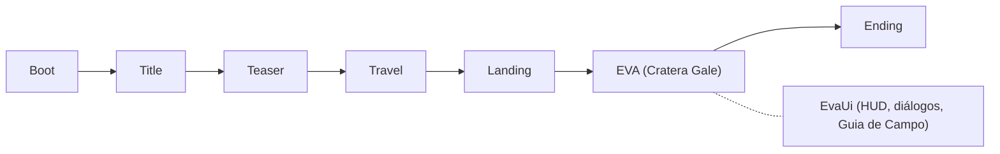
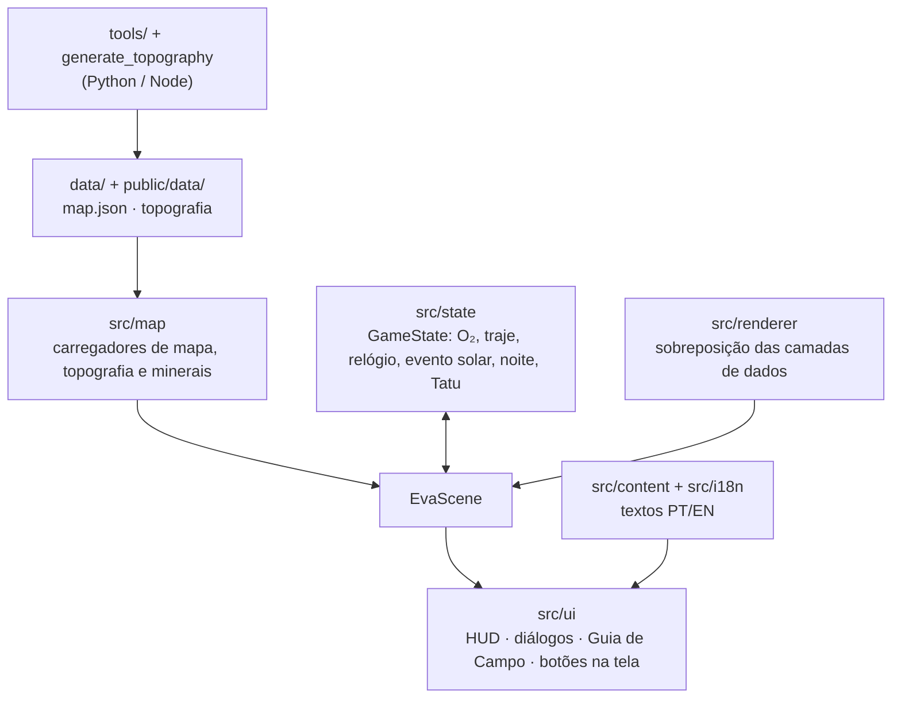

<div align="center">

# Ankerona: Missão Marte

**Um guia de sobrevivência em Marte que se joga.**
Jogo 2D em pixel art, no navegador, em que cada descoberta vem com o dado real e a fonte.

*Missão hipotética · dados reais da NASA*

### ▶ [Jogue agora: ankerona.vercel.app](https://ankerona.vercel.app)

NASA Space Apps Challenge 2026 · Desafio **Interplanetary Survival Guide: Martian Map** · Equipe **Seldon Expedition** (Recife, Brasil)

🌐 **[English](README.md)** · **Português** · [Como rodar](#como-rodar) · [Fontes e referências](#fontes-e-referências) · [Documentação](#documentação)

</div>

---

## Sumário

1. [O problema](#o-problema)
2. [A solução](#a-solução)
3. [Como o jogo se conecta ao desafio](#como-o-jogo-se-conecta-ao-desafio)
4. [O jogo](#o-jogo)
5. [Dados científicos usados no jogo](#dados-científicos-usados-no-jogo)
6. [Fontes e referências](#fontes-e-referências)
7. [Documentação](#documentação)
8. [Stack tecnológica](#stack-tecnológica)
9. [Arquitetura](#arquitetura)
10. [Como rodar](#como-rodar)
11. [Estrutura do repositório](#estrutura-do-repositório)
12. [Como contribuir](#como-contribuir)
13. [Equipe](#equipe)
14. [Uso de IA e créditos](#uso-de-ia-e-créditos)
15. [Licença](#licença)

---

## O problema

**57% da população mundial diz saber pouco ou nada sobre ciência.** Ao mesmo tempo, **62% querem saber mais**, mas só **28% procuraram informação científica no último mês** (Wellcome Global Monitor 2018, com mais de 140 mil pessoas em mais de 140 países).

A curiosidade existe, mas o acesso não acompanha. Enquanto isso, a NASA mantém um volume enorme de dados planetários abertos: só um dos núcleos do seu arquivo planetário, o PDS Geosciences Node, guarda cerca de 390 TB. São dados públicos, mas técnicos, em inglês e difíceis de explorar para quem não é especialista.

## A solução

O **Ankerona** transforma dados reais das missões a Marte num **guia de campo jogável**.

A jogadora controla a geóloga **Ana Selari** numa missão tripulada (hipotética) à **Cratera Gale**, onde o rover Curiosity trabalha desde 2012. Ela percorre uma rota com alvos científicos reais, administra oxigênio, bateria e traje, enfrenta um evento de partículas solares e volta ao habitat. Cada descoberta entra no Guia de Campo com o dado, a lição de sobrevivência e a **fonte**.

- **Gratuito** e roda no navegador, inclusive no celular.
- **Bilíngue:** português (PT-BR) e inglês (EN-US).
- **Sem ficção científica:** a missão é hipotética e isso é dito no jogo, mas toda a ciência é real e citada. Quando um valor é simulado para fins de jogabilidade, o próprio jogo avisa.

## Como o jogo se conecta ao desafio

O desafio pede uma visão integrada e em camadas de um local ou rota em Marte, reunindo dados de várias missões científicas da NASA, para ajudar um explorador humano a planejar e realizar uma caminhada na superfície (Marswalk), fazendo ciência no caminho.

| O que o desafio pede | Como o Ankerona responde |
|---|---|
| Um local ou rota na superfície de Marte | Uma rota na Cratera Gale: habitat → Yellowknife Bay → Dunas Bagnold → formações boxwork → retorno |
| Visão em camadas | Camadas alternáveis: **Mapa**, **Topografia**, **Minerais** e **Terreno** (areia fofa e rochas pontiagudas) |
| Dados de várias missões da NASA | Curiosity (RAD, REMS, Mastcam, APXS), Mars Odyssey (MARIE), Phoenix, Spirit, Opportunity, Perseverance (SuperCam) e MRO (HiRISE e CRISM como base das camadas) |
| Planejar a Marswalk | Gestão de O₂, bateria e integridade do traje; terreno que bloqueia ou desgasta; abrigos (habitat e rover pressurizado) |
| Condições atuais | Painel de clima e radiação do Tatu, dose acumulada em mSv e alerta de evento solar |
| Ciência ao longo do caminho | Cada alvo tem briefing (o que é, por que ir, o que procurar, fonte) e uma entrada no Guia de Campo |

> **Pendente:** cruzar esta tabela, item a item, com a lista oficial da aba *Resources* da página do desafio.

## O jogo

**Gênero:** aventura 2D em pixel art, no estilo de console portátil de 8 bits, com começo, meio e fim.

### Fluxo

1. **Prólogo:** a história da exploração espacial até Marte, a viagem de cerca de 7 meses e um alerta de tempestade solar na nave.
2. **Pouso (EDL):** entrada com escudo térmico, paraquedas e descida propulsada até o toque no solo, os "7 minutos de terror".
3. **Fase 1 · Yellowknife Bay:** rochas que registram um antigo lago.
4. **Fase 2 · Dunas Bagnold:** dunas ativas e areia fofa.
5. **Evento solar:** chegada de partículas solares, corrida até o abrigo com a tripulação e consequências reais da exposição.
6. **Fase 3 · Formações boxwork:** cristas minerais no Monte Sharp, atravessando rochas pontiagudas.
7. **Retorno e epílogo:** volta ao habitat e a mensagem final, *"Agora o caminho é de vocês."*

### Personagens

- **Ana Selari**, geóloga e protagonista.
- **Cmdte. Keli Hastor**, **Eng. Rossi Brook** e **Dr. Natan Jonas**, a tripulação.
- **Tatu**, o rover-guia. Ele vai à frente mostrando o caminho e reúne os dados da missão: alvo, guia, clima, radiação e mapa da cratera. Detalhes na seção 04 da [**Documentação do Ankerona**](docs/pt-br/ankerona-documentacao.md).

Perfis completos na seção 03 da [**Documentação do Ankerona**](docs/pt-br/ankerona-documentacao.md).

O nome **Ankerona** junta as primeiras sílabas de **An**ca, **Ke**lly, **Ro**ss e **Na**than, a tripulação da primeira missão **CHAPEA** da NASA, que viveu 378 dias num habitat que simula Marte (2023–2024). Os nomes dos personagens também homenageiam essa tripulação. A história completa está na seção 02 da [**Documentação do Ankerona**](docs/pt-br/ankerona-documentacao.md).

### Mecânicas

- **Recursos:** O₂, bateria e traje. Camadas de dados gastam bateria, a areia fofa gasta mais O₂ e rochas pontiagudas danificam o traje.
- **Radiação:** dose acumulada em mSv. Durante o evento solar, ficar do lado de fora aumenta a dose e pode abortar a caminhada.
- **Guia de Campo:** 9 entradas principais e 3 extras escondidas (marcadas por um brilho quando a jogadora está perto).

## Dados científicos usados no jogo

### Guia de Campo

| # | Entrada | Dado principal | Missão / instrumento | Fonte |
|---|---|---|---|---|
| 1 | Radiação na viagem | ~1,8 mSv/dia no cruzeiro até Marte | MSL · RAD | Zeitlin et al., *Science*, 2013 |
| 2 | O ambiente de Marte | Gravidade de 38% da terrestre, pressão abaixo de 1% e sol de 24h39min | — | NASA Mars Exploration Program |
| 3 | Poeira tóxica | Percloratos no solo, tóxicos para humanos | Phoenix (2008); MSL Curiosity | NASA/JPL |
| 4 | Marte já teve água | Argilominerais em Yellowknife Bay: antigo lago de água pouco salgada e pH neutro | MSL Curiosity | Grotzinger et al., *Science*, 2014 |
| 5 | Areia fofa | Dunas Bagnold ativas (2015–2016); Spirit atolou em solo fofo em 2009 | MSL Curiosity; MER Spirit | NASA/JPL-Caltech |
| 6 | Energia e poeira | Tempestade global de 2018; último contato com o Opportunity em 10/06/2018; missão encerrada em fev. 2019 | MER Opportunity | NASA/JPL |
| 7 | Partículas solares | ~0,64 mSv/dia em média na superfície | MSL · RAD | Hassler et al., *Science*, 2014 |
| 8 | Rochas pontiagudas | Furos e rasgos nas rodas de alumínio do Curiosity no fim de 2013 | MSL Curiosity | NASA/JPL · relatórios da missão (2013–2014) |
| 9 | Formações boxwork | Cristas minerais deixadas por água subterrânea, estudadas em 2025 no Monte Sharp | MSL Curiosity | NASA/JPL-Caltech (2025) |
| E1 | Relógio da erosão | Rochas de Yellowknife Bay expostas há ~80 milhões de anos | MSL Curiosity | NASA/JPL-Caltech/MSSS · PIA17595 |
| E2 | Duna Namib | Face de ~28° de inclinação e ~5 m de altura; dunas avançam até ~1 m por ano | MSL Curiosity · Mastcam | NASA/JPL-Caltech/MSSS · PIA20284 |
| E3 | Cristais de enxofre | Primeiro enxofre puro em Marte, em 30/05/2024 (sol 4.200), no canal Gediz Vallis | MSL Curiosity · APXS | NASA/JPL-Caltech · PIA26309 |

### Outros dados do jogo

| Elemento | Dado | Fonte |
|---|---|---|
| Evento solar | Em 2003, uma tempestade solar danificou o instrumento MARIE, da Mars Odyssey | NASA/JPL · Mars Odyssey |
| Limite de radiação | Limite de carreira de 600 mSv para astronautas da NASA | NASA-STD-3001 |
| Painel de clima | O REMS mede ar, solo, pressão, umidade, vento e UV desde 2012; em Gale, a variação entre dia e noite passa de 60 °C | Gómez-Elvira et al., *Space Science Reviews*, 2012 |
| Som do vento | Primeiras gravações de som em Marte, pelo microfone da SuperCam | Maurice et al., *Nature*, 2022 |
| Viagem | Travessia de ~7 meses, o mesmo tempo do Perseverance | NASA/JPL · Mars 2020 |

### Fotos reais no jogo

O Guia de Campo mostra, num tablet de campo, fotos tiradas pelo Curiosity:

| Imagem | Conteúdo |
|---|---|
| PIA17595 | Formação de Yellowknife Bay, com os pontos de perfuração (sol 137) |
| PIA20284 | Panorama 360° ao lado da Duna Namib, Dunas Bagnold (sol 1.197) |
| PIA20334 | Inspeção de desgaste das rodas do Curiosity |
| PIA26309 | Rocha Convict Lake quebrada, com cristais de enxofre |
| PIA26559 | Primeira vista 360° das formações boxwork (sols 4.451 a 4.454) |

Crédito das imagens: NASA/JPL-Caltech/MSSS. Todas estão em [`public/assets/guide/`](public/assets/guide/).

### O que é simulado

Para manter a jogabilidade, algumas coisas são simuladas. O jogo avisa a jogadora quando isso acontece:

- a missão tripulada e a tripulação;
- as taxas de dose e o tempo de aviso do evento solar;
- os valores do painel de clima;
- o terreno, que é ilustrativo e não segue a orientação norte-sul (o mapa esquemático da cratera segue).

## Fontes e referências

Versão completa e formatada: seção 01 da [**Documentação do Ankerona**](docs/pt-br/ankerona-documentacao.md).

### Artigos científicos

- Zeitlin, C. et al. (2013). Measurements of Energetic Particle Radiation in Transit to Mars on the Mars Science Laboratory. *Science*, 340(6136), 1080–1084.
- Hassler, D. M. et al. (2014). Mars' Surface Radiation Environment Measured with the Mars Science Laboratory's Curiosity Rover. *Science*, 343(6169).
- Grotzinger, J. P. et al. (2014). A Habitable Fluvio-Lacustrine Environment at Yellowknife Bay, Gale Crater, Mars. *Science*, 343(6169).
- Gómez-Elvira, J. et al. (2012). REMS: The Environmental Sensor Suite for the Mars Science Laboratory Rover. *Space Science Reviews*, 170, 583–640.
- Maurice, S. et al. (2022). In situ recording of Mars soundscape. *Nature*, 605, 653–658.

### NASA

- NASA Mars Exploration Program: fatos sobre o ambiente de Marte.
- NASA/JPL-Caltech: missões Mars Science Laboratory (Curiosity), Mars Exploration Rovers (Spirit e Opportunity), Phoenix, Mars Odyssey e Mars 2020 (Perseverance).
- NASA Photojournal: PIA17595, PIA20284, PIA20334, PIA26309 e PIA26559.
- NASA-STD-3001: padrão de saúde e desempenho da tripulação, com o limite de exposição à radiação na carreira.
- NASA CHAPEA (Crew Health and Performance Exploration Analog): inspiração para os nomes da tripulação.

### Contexto do problema

- Wellcome Global Monitor 2018: [visão geral](https://wellcome.org/insights/reports/wellcome-global-monitor-2018) · [Cap. 2, compreensão e interesse em ciência](https://wellcome.org/insights/reports/wellcome-global-monitor/2018/chapter-2-understanding-and-interest-science-and-health).
- Washington University in St. Louis: [PDS Geosciences Node, ~390 TB de dados](https://research.washu.edu/?p=4888).

### Desafio

- NASA Space Apps Challenge 2026: [Interplanetary Survival Guide: Martian Map](https://www.spaceappschallenge.org/2026/challenges/interplanetary-survival-guide-martian-map/).

## Documentação

Toda a documentação complementar está num único arquivo: [**Documentação do Ankerona**](docs/pt-br/ankerona-documentacao.md). Também disponível [em inglês](docs/en/ankerona-documentation.md).

| Seção | Conteúdo |
|---|---|
| 01 · Referências científicas do jogo | Todos os dados do jogo, com missão, instrumento e fonte; fotos reais; o que é simulado; artigos e fontes da NASA |
| 02 · De onde vem o nome Ankerona | A missão CHAPEA 1 da NASA e a ligação entre a tripulação real e os personagens |
| 03 · Personagens | Ana Selari, Cmdte. Keli Hastor, Eng. Rossi Brook e Dr. Natan Jonas: papel no jogo, retrato e sprite |
| 04 · O robô Tatu | O rover-guia: como se comporta, as seis funções do painel de dados e a base real de cada uma |

## Stack tecnológica

| Área | Tecnologia |
|---|---|
| Motor do jogo | [Phaser](https://phaser.io/) 4.2.1 (WebGL/Canvas, modo `pixelArt`) |
| Linguagem | TypeScript |
| Build e servidor de desenvolvimento | Vite |
| Interface | HTML e CSS sobre o canvas do jogo (container DOM do Phaser), com botões na tela em aparelhos de toque |
| Fontes | Press Start 2P e VT323, empacotadas com o Fontsource para funcionar sem internet |
| Traduções | Arquivos JSON por idioma (`src/content/pt.json`, `src/content/en.json`) |
| Ferramentas de dados | Scripts em Python e Node.js que geram o mapa e a topografia |
| Hospedagem | Vercel ([ankerona.vercel.app](https://ankerona.vercel.app)) |
| Versionamento | Git e GitHub, com branches e Pull Requests revisados |

Tela interna de 160×144 pixels, tiles de 16×16, paleta de "óxido de ferro", ampliada sem suavização. Custo zero: só ferramentas e bibliotecas gratuitas e de código aberto.

## Arquitetura

O jogo é uma aplicação web de página única. O `src/main.ts` cria o jogo Phaser em 160×144, mantém a proporção em qualquer tela (`Scale.FIT`), monta os botões na tela no celular e registra as cenas em ordem.

### Fluxo de cenas



| Cena | Papel |
|---|---|
| `BootScene` | Carrega arquivos e dados |
| `TitleScene` | Tela de título e seletor de idioma |
| `TeaserScene` | Prólogo com a história da exploração espacial |
| `TravelScene` | A viagem até Marte e o alerta de tempestade solar |
| `LandingScene` | Entrada, descida e pouso (EDL) |
| `EvaScene` + `EvaUiScene` | A caminhada na Cratera Gale; a cena de interface roda por cima, com HUD, diálogos e Guia de Campo |
| `EndingScene` | Epílogo e resumo da missão |

### Módulos



| Pasta | Responsabilidade |
|---|---|
| `src/scenes/` | Fluxo do jogo, uma cena por etapa (`eva/` guarda as partes do mapa da EVA e do evento solar) |
| `src/state/` | Estado e regras do jogo: oxigênio, traje, relógio marciano, noite, evento solar, Tatu |
| `src/map/` | Carrega o mapa (`map.json`), a topografia e a camada de minerais, e responde perguntas como "este tile é transitável?" |
| `src/renderer/` | Desenha as camadas de dados (mapa, topografia, minerais, terreno) sobre a cena |
| `src/ui/` | HUD, caixa de diálogo, Guia de Campo, telas, controles e botões na tela |
| `src/content/` + `src/i18n/` | Todos os textos do jogo em português e inglês |
| `src/audio/` | Áudio do jogo |
| `tools/`, `generate_topography.*` | Scripts offline que geram o `data/map.json` e os arquivos de topografia em `public/data/` |

A topografia em `public/data/` é uma aproximação procedural da Cratera Gale baseada em modelos de terreno do HiRISE (DTMs ESP_016893_1755 e ESP_017173_1755), com o areoide do MOLA como referência de altitude.

## Como rodar

**Jogar online:** [ankerona.vercel.app](https://ankerona.vercel.app), sem instalar nada.

Para rodar no seu computador:

**Pré-requisitos:** [Git](https://git-scm.com) e [Node.js](https://nodejs.org) LTS (v20 ou mais).

```bash
git clone https://github.com/matheusalvescds/Ankerona.git
cd Ankerona
npm install
npm run dev
```

Abra **http://localhost:5173**. O jogo recarrega sozinho a cada mudança.

| Comando | O que faz |
|---|---|
| `npm run dev` | Servidor de desenvolvimento em `localhost:5173` |
| `npm run build` | Confere os tipos e gera a versão final em `dist/` |
| `npm run preview` | Abre a versão de `dist/` para testar |
| `npm run typecheck` | Só confere os tipos |

Para atualizar: `git pull` e depois `npm install`. Mais detalhes em [`docs/desenvolvimento.md`](docs/desenvolvimento.md).

### Controles

| Ação | Teclado | Tela |
|---|---|---|
| Mover | Setas ou WASD | Direcional |
| Confirmar / falar | Z, Enter ou Espaço | A |
| Voltar | X, Esc ou Backspace | B |
| Trocar camada de dados | C ou Q | Botão de camada no HUD |
| Guia de Campo | G | — |
| Dados do Tatu | T | TATU |
| Lupa (zoom) | V | Botão de lupa no HUD |
| Mapa da cratera | M | Botão de mapa no HUD |

## Estrutura do repositório

```
ankerona/
├── data/                  # dados do mapa (map.json); ver data/LEIAME.md
├── docs/                  # documentação do Ankerona
│   ├── pt-br/             # em português
│   ├── en/                # em inglês
│   ├── desenvolvimento.md # como instalar, rodar e contribuir (PT/EN)
│   └── juncao-prototipos.md # como os protótipos foram juntados (PT/EN)
├── prototipo/             # protótipos de referência (HTML, CSS e JS) e textos PT/EN
├── public/
│   ├── assets/
│   │   ├── audio/         # músicas e efeitos sonoros
│   │   ├── guide/         # fotos reais da NASA usadas no Guia de Campo
│   │   ├── sprites/       # sprites transparentes, organizados por categoria
│   │   └── teaser/        # arte do teaser
│   ├── data/              # dados de mapa e topografia carregados pelo jogo
│   └── favicon.ico …      # ícones do site
├── src/                   # código do jogo (Phaser + TypeScript)
│   ├── scenes/            # cenas Boot, Title, Teaser, Travel, Landing, EVA e Ending
│   ├── map/               # carregadores de mapa, topografia e camada de minerais
│   ├── audio/ content/ i18n/ renderer/ state/ ui/
│   ├── config.ts
│   └── main.ts
├── tools/                 # gerador do mapa (generate_map.py / .cjs)
├── generate_topography.py # gerador da topografia (também em .cjs)
├── index.html
├── package.json
├── tsconfig.json
└── vite.config.ts
```

## Como contribuir

- **Nunca faça commit direto na `main`.**
- Crie uma branch para cada alteração (por exemplo, `feat/painel-tatu` ou `fix/guia-entrada-8`).
- Abra um Pull Request e peça revisão de **outra pessoa** do time. Não aprove nem faça merge do seu próprio PR.
- A única exceção é uma urgência real sem ninguém disponível para revisar.
- Todo dado científico novo precisa de fonte, no padrão `Fonte: NASA/JPL-Caltech · Missão (ano)`.

## Equipe

**Seldon Expedition**, Recife, Brasil.

| Pessoa | Papel |
|---|---|
| Matheus | Scrum Master e Design |
| Jonatha | Desenvolvimento |
| Miguel | Desenvolvimento |
| Arthur | Desenvolvimento |
| Aylton | Pesquisa |
| Bruno | Pesquisa |

## Uso de IA e créditos

- Ferramentas de IA generativa (Claude, ChatGPT e Gemini) foram usadas como apoio em pesquisa, prototipagem, revisão de textos e geração de arte. A arte final foi selecionada, recortada e ajustada pela equipe.
- Os clipes de fundo do vídeo de apresentação foram gerados com o Google Flow.
- Os dados científicos foram conferidos nas fontes listadas acima.
- Imagens de Marte: NASA/JPL-Caltech/MSSS. Este projeto não usa a marca oficial da NASA e não é endossado pela NASA.

## Licença

O código e a arte original da equipe estão sob a [Licença MIT](LICENSE). © 2026 Seldon Expedition.

Conteúdos de terceiros mantêm os próprios termos:

- **Imagens de Marte:** NASA/JPL-Caltech/MSSS, usadas com crédito, de acordo com as diretrizes de mídia da NASA.
- **Fontes:** Press Start 2P e VT323, sob a SIL Open Font License.
- **Marca da NASA:** este projeto não usa a marca oficial da NASA e não é endossado pela NASA.

---

*Este README também está disponível em [inglês](README.md).*
